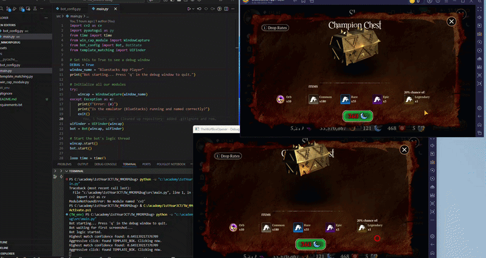

# The Wolf MMORPG - Automated Loot Box Bot

This project is an automated, computer-vision-driven bot designed to interact with "The Wolf MMORPG" running inside the BlueStacks 5 Android emulator on Windows. Specifically, it automates the tedious process of opening loot boxes and collecting rewards.

## Demo Video 




## Requirements

* **OS:** Windows *(relies on `win32gui` / `win32ui` for hardware-accelerated window capture).*
* **Environment:** Python 3.x.
* **Emulator:** BlueStacks 5.


Run the following command in the project root to install necessary libraries (OpenCV, PyAutoGUI, and PyWin32):

```bash
pip install -r requirements.txt

```

* Create a new BlueStacks 5 instance.
* ⚠️ **Crucial:** The window title must be exactly `"Bluestacks App Player"`. The `WindowCapture` module uses this strict string to hook the window handle (`hwnd`) and calculate DPI-aware crop offsets.


* Sideload **"The Wolf MMORPG Modded APK (Free shopping)"** into the configured BlueStacks instance.

---


1. Launch the game within the emulator and navigate to the target UI state (e.g., the box-opening view).
2. Initialize the state machine and capture threads from the project root by running:

```bash
python src/main.py

```

---


* ⚠️ **Safe Exit:** Do not forcefully close the emulator or terminal.
* Bring the OpenCV simulation window (`"TheWolfBoxOpener - Debug"`) into focus and press **`q`**.
* This sends the interrupt signal to gracefully terminate the capture and bot threads (`wincap.stop()`, `bot.stop()`) and safely release memory/window handles.
